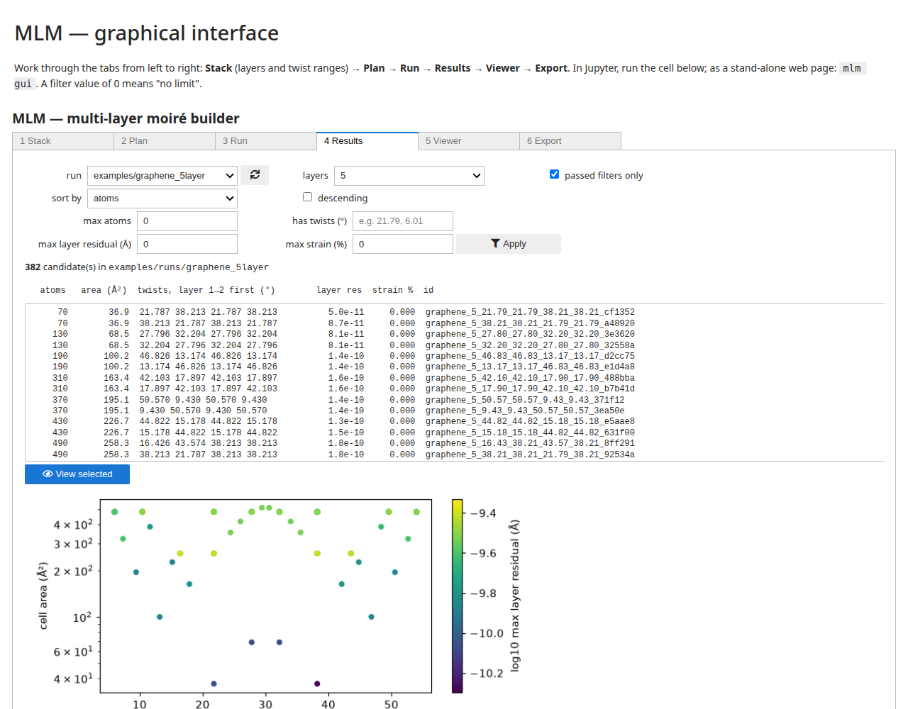

# MLM — Multi-Layer Moiré

**A Python package for building commensurate supercells of twisted multilayer 2D materials.**

Twisting two (or more) atomically thin layers relative to each other produces *moiré* superlattices — the physical substrate for some of the most exciting phenomena in modern condensed-matter physics (flat bands, unconventional superconductivity, correlated insulators, ferroelectric polarization textures). Before those systems can be simulated with DFT or MD, one has to find a *commensurate* supercell: a finite box in which the twisted pattern closes back on itself under periodic boundary conditions.

MLM does that fast, for any Bravais lattice, and — unlike the existing bilayer-focused tools — for **three or more layers** with independent twist angles.

**Capstone project, University of Southern California (Mork Family Department of Chemical Engineering and Materials Science). Manuscript in preparation.**

---

## Why it's interesting

- **Algorithmic speedup.** The standard brute-force coincidence search is $\mathcal{O}(N^4)$ in the search range $N$. MLM reformulates it as a *solve-and-round* problem: for each bottom-layer lattice vector $\mathbf{v}$, the matching top-layer indices $\mathbf{m}$ are obtained by a single $2\times 2$ linear solve $B(\theta)\,\mathbf{m}=\mathbf{v}$. That drops the scaling to $\mathcal{O}(N^2)$ and gives 10²–10³× speedups at practical search ranges; a vectorised scanner adds another 10–70× with identical results.
- **Any number of layers.** Existing tools (e.g. TWISTER) are bilayer-only. MLM builds an N-layer stack as a tournament tree of pairwise searches — (1,2) (3,4) → (12)(34) → … — with an independent twist window at every interface, treating each block's moiré cell as the lattice for the next search.
- **Lattice-agnostic.** No hidden assumptions about hexagonal symmetry — works for graphene, TMDCs (MoS₂), perovskite oxides (SrTiO₃, PbTiO₃, BaTiO₃), and heterostructures (PTO+STO) with mismatched lattice constants, which can be **strained** to an exact match (isotropic, axial or full strain; optionally shared by elastic constants).
- **Scales to millions of atoms.** Atom selection uses fractional-coordinate folding + a two-pass deduplicator (integer binning + periodic KD-tree), avoiding the polygon-clipping tolerances that usually break at small twist angles.
- **Every structure is checked.** Before a file is written, MLM checks atom counts, overlaps, interlayer distances and the **periodic-boundary seam**: every atom must have the same neighbours as in its primitive layer, so a broken or doubled atom at the box edge is caught without opening the file in a viewer.

---

## Highlight: every five-layer twisted graphene stack

`examples/runs/graphene_5layer` contains **all 382 five-layer graphene stacks with fewer than 1000 atoms** (111 distinct up to flipping and mirroring), with any twist from 0.5° to 59.5° at each of the four interfaces, plus VASP files of the 111 distinct stacks (3.35 Å between sheets, every file checked). 53 of them have four different interface twists; the smallest has 490 atoms (16.43°, 43.57°, 38.21°, 21.79°).

The same search (`dev/graphene_5layer_deep_search.py`: exact commensurate twists in closed form + adaptive search ranges) scales to large cells on one workstation:

| atom budget | bilayer twists | five-layer stacks | distinct | time |
|---|---|---|---|---|
| 1 000 | 28 | 382 | 111 | 25 s |
| 10 000 | 274 | 14 182 | 3 891 | 1 min |
| 40 000 | 1 098 | 138 182 | 39 178 | 15 min |
| 80 000 | 2 206 | 359 666 | 105 292 | 1.4 h |

(18 processes on a 20-thread workstation; the 1000-atom run used 4.)

Browse them in the GUI (**Results** tab → `examples/graphene_5layer`, sort by atoms, filter by twists) or from the command line:

```bash
mlm find examples/runs/graphene_5layer --n-layers 5 --max-atoms 500 --sort n_atoms
mlm write examples/runs/graphene_5layer <id> --fmt lammps --gap -2.5023   # 3.35 Å between sheets
```

---

## Gallery

Structures generated by MLM and rendered in OVITO.

**Trilayer MoS₂ — θ₁ = 21.79°, θ₂ = 38.21°**

| Top view | Side view |
|:---:|:---:|
|  |  |

A three-layer twisted MoS₂ stack — the hierarchical moiré pattern emerges from two independent twist angles, something bilayer-only codes cannot produce.

**Bilayer PbTiO₃ / SrTiO₃ heterostructure — 87°**

| Top view | Side view |
|:---:|:---:|
|  |  |

A perovskite-oxide heterobilayer with mismatched lattice constants. MLM reports a per-structure residual δ_vec so the user can pick an acceptable approximate-commensurability tolerance for their simulation.

---

## Install

```bash
git clone https://github.com/anikeya9/Multi-Layer-Moire-Generator-MLM.git
cd Multi-Layer-Moire-Generator-MLM
git checkout quality-improvements
pip install -e ".[all]"          # package + GUI + checks + notebooks + dev tools
```

Tested on Python 3.10, 3.12 and 3.13 (CI). Core dependencies: NumPy, pandas, Polars, SciPy, ASE, Numba; the GUI adds ipywidgets, py3Dmol and Voilà; the space-group check uses spglib. `pip install -e .` installs the core only.

---

## Getting started

**1. The feature tour** — `notebooks/feature_tour.ipynb` demonstrates every feature with a short explanation each, including a five-layer graphene stack; it runs in about two minutes.

**2. The graphical interface**

```bash
mlm gui                # opens in the browser; Ctrl+C stops it (or: python -m MLM gui)
```

In Jupyter, open `notebooks/mlm_gui.ipynb` instead. Work through the tabs from left to right:

| Tab | What it does |
|---|---|
| 1 Stack | layers (any POSCAR or CIF, strain limit, elastic constants), a twist range per interface, cell angle, residual limits |
| 2 Plan | dry run: which blocks are joined in which round, and a time estimate |
| 3 Run | runs in the background with a progress bar; Stop, and Resume later |
| 4 Results | your runs and the shipped examples; **sort by any column** (atoms, area, residual, strain, twists), **filter** by atoms, twists, residual, strain; scatter plot |
| 5 Viewer | 3D view coloured by layer or element, hide layers, 2×2 / 3×3 repeat, top / side view; layer table, checks, lineage |
| 6 Export | VASP / LAMMPS with interlayer gap, vacuum, lateral shifts, Poisson thickness; download links |



**3. The command line**

```bash
mlm run examples/bto_trilayer_demo.yaml --workers 4            # stack spec -> runs/bto_trilayer_demo
mlm find runs/bto_trilayer_demo --n-layers 3 --sort n_atoms     # query the index
mlm show runs/bto_trilayer_demo <id>                            # recipe and lineage
mlm write runs/bto_trilayer_demo <id> --fmt lammps              # rebuild atoms, check, write
mlm check runs/bto_trilayer_demo <id>                           # sanity checks only
```

**4. Python**

```python
from MLM.structure import MoireStructure
from MLM.search import SearchParams, SearchSchedule, Filters, build_stack
from MLM.build import write_structure

bto = MoireStructure.from_poscar("moire_structures/bto/bto_1-layer.vasp", "bto")
schedule = SearchSchedule(SearchParams(degmin=22, degmax=23), rounds={2: {"nmin": -40, "nmax": 40}},
                          interfaces={2: {"degmin": 36.5, "degmax": 37.5}})
result = build_stack([bto] * 3, schedule, Filters(max_residual=1e-3), run_dir="runs/bto3")
write_structure("runs/bto3", result.final[0].id, fmt="vasp")
```

Step-by-step tutorial: [`docs/TUTORIAL.md`](docs/TUTORIAL.md).

---

## What's in the `quality-improvements` branch

**Search**
- N-layer stacks as a tournament tree, a twist window per interface, dry run with time estimates.
- Vectorised scanner: 10–70× faster than `match.py` with identical matches (a full BTO trilayer search from ~50 min to 23 s, 8 s on 4 cores); `match.py` itself is unchanged and stays the reference.
- Parallel searches (`workers`), clean stop and **resume** of interrupted runs.
- Options: lattice points on the axes (`include_axes`), any number of matches per angle, merging of symmetry-equivalent twists.

**Physics**
- Heterostrain: layers strained to an exact match within a limit (isotropic / axial / full), shared in proportion to the limits or by elastic constants (Young's modulus, Poisson ratio), with the strain energy of every cell.
- Poisson thickness change of strained layers, lateral layer shifts (e.g. AB stacking).

**Structures and checks**
- Atoms rebuilt on demand from small YAML recipes; VASP and LAMMPS output.
- Checks before every write: atoms per layer, composition, overlaps, interlayer distance, PBC seam check (works for strained layers and heterostructures), space group (`mlm check`).
- Fast, low-memory writer: a 145 000-atom LAMMPS file in 3 s and 0.5 GB (was 852 s and 5.6 GB).

**Finding structures**
- Every candidate (rejected ones too) is kept: one YAML recipe each, plus an index table (CSV, or SQLite for very large runs) with residuals, strain, cell area, **number of atoms** and the **twists in stacking order**.
- `find` / `mlm find` filter and sort it; `lineage` shows how a structure was built; `run_info.yaml` records versions, git commit and timings of every run.

**Inputs and tooling**
- Layer files read with ASE: any POSCAR (Direct, scale factor, Selective Dynamics) or CIF.
- 171 tests, `ruff`, `mypy`, pre-commit and GitHub Actions CI (Python 3.10–3.13, notebooks executed).

Details and measured numbers: [`docs/IMPLEMENTATION_NOTES.md`](docs/IMPLEMENTATION_NOTES.md) §9; conventions and design decisions: [`docs/DESIGN.md`](docs/DESIGN.md).

---

## Repository layout

```
src/MLM/
  match.py                  # solve-and-round bilayer search (reference implementation, unchanged)
  fastscan.py               # vectorised version of match.run, identical results
  search.py                 # pairwise search, filters, tournament tree (build_stack)
  strain.py                 # heterostrain fitting and elastic energy
  structure.py, index.py    # YAML recipes, run directories, index table, find / get / lineage
  build.py, checks.py       # rebuild atoms, write VASP / LAMMPS, sanity and PBC seam checks
  spec.py, cli.py, gui.py   # stack-spec YAML jobs, the `mlm` command, the graphical interface
  structure_writer.py       # replication + fractional-coordinate atom selection
examples/                   # stack specs; examples/runs/ holds finished runs (incl. graphene_5layer)
notebooks/                  # feature tour, GUI, stack explorer, and the original bilayer/trilayer notebooks
moire_structures/           # layer POSCARs and pre-computed structures
dev/                        # notebook generators, benchmarks, the five-layer graphene search
docs/                       # tutorial, implementation notes, design, GUI screenshots
tests/                      # pytest suite
assets/                     # figures
```

---

## The original notebooks

The notebooks the project started from still work and show the method step by step:

| Notebook | What it does |
|---|---|
| `Bi-layer_structure_finder.ipynb` | Find all commensurate bilayer moiré angles for a given material and search range |
| `Bi-layer-str-writer.ipynb` | Build the atomic structure for a chosen bilayer candidate and write VASP / LAMMPS files |
| `trilayer_candidate_finder.ipynb` | Extend the bilayer result to a trilayer stack — find a third commensurate layer |
| `trilayer_structure_creator.ipynb` | Build and export the full trilayer atomic structure |

---

## Skills demonstrated

Scientific Python (NumPy / SciPy / Polars), JIT compilation (Numba), vectorisation and parallelism (multiprocessing), computational geometry and change-of-basis linear algebra, number theory of commensurate lattices, algorithm design (complexity reduction from $N^4 \to N^2$), computational materials science (DFT / MD input generation, VASP & LAMMPS I/O via ASE), interactive scientific GUIs (ipywidgets, Voilà, py3Dmol), software engineering (tests, CI, typing), and technical writing for peer-reviewed publication.

---

## Contact

**Anikeya Aditya** — [anikeya9@gmail.com](mailto:anikeya9@gmail.com)
