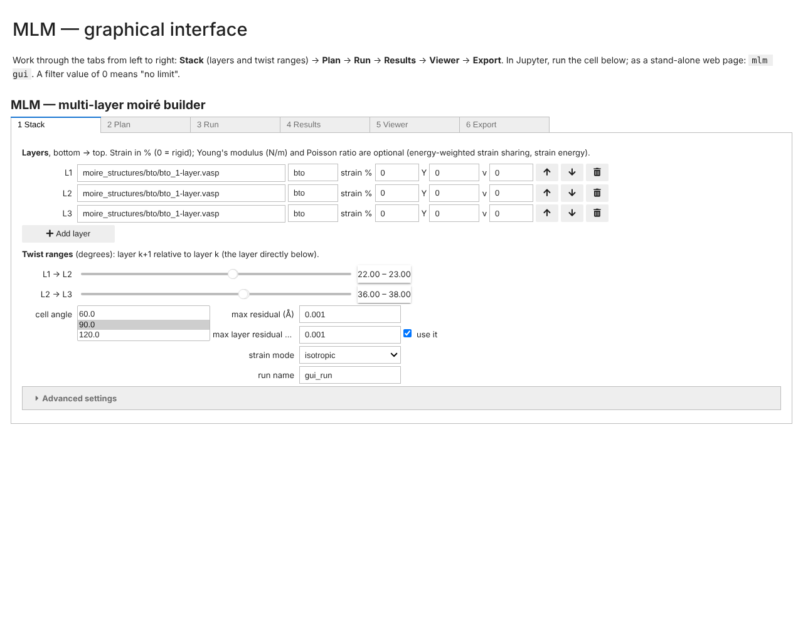
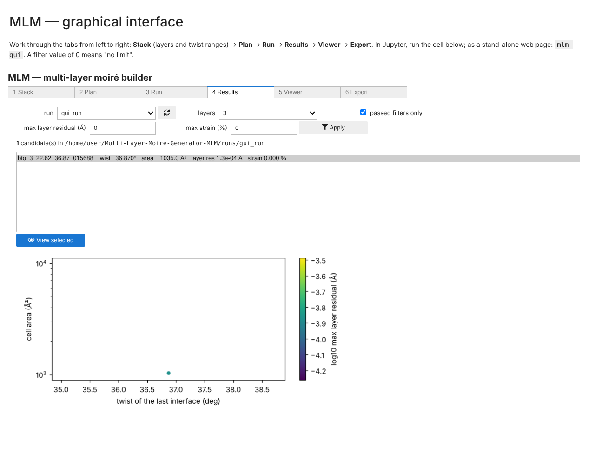
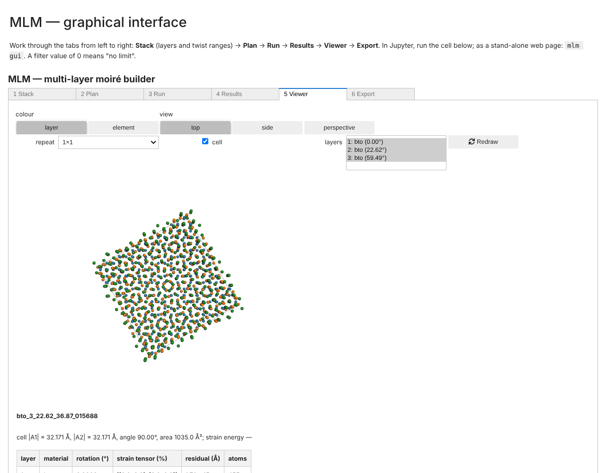
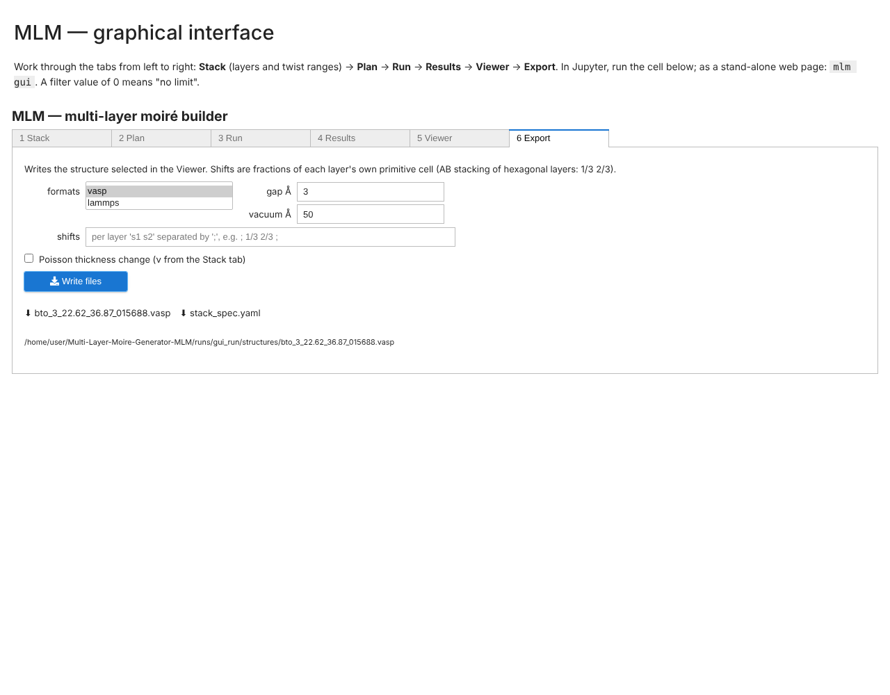

# MLM tutorial: the `with-straining` and `quality-improvements` branches

This tutorial shows how to use the two newest branches of MLM, step by step. Part A covers
everything that both branches can do. Part B covers what only `quality-improvements` adds.
Every code example below has been run on the branch it is written for.

- [0. Which branch should I use?](#0-which-branch-should-i-use)
- [1. Getting a branch and installing it](#1-getting-a-branch-and-installing-it)
- [Part A — the YAML workflow and heterostrain (both branches)](#part-a--the-yaml-workflow-and-heterostrain-both-branches)
- [Part B — what `quality-improvements` adds](#part-b--what-quality-improvements-adds)
- [2. Moving between branches](#2-moving-between-branches)
- [3. Troubleshooting](#3-troubleshooting)
- [4. Cheat sheet](#4-cheat-sheet)

---

## 0. Which branch should I use?

The branches build on each other; each one contains everything of the one before:

```
dev ──► claude-edits ──► with-straining ──► quality-improvements
        YAML recipes,     + heterostrain      + GUI, 10–70× faster search, parallel runs,
        N-layer search,     (exact strained     stop/resume, structure checks, layer shifts,
        index, CLI          matches)            Poisson, elastic constants, CIF input,
                                                feature-tour notebook, CI
```

| You want to… | Use |
|---|---|
| work with the newest, fastest, best-tested version (recommended) | `quality-improvements` |
| reproduce results exactly as produced by the strain feature when it was first added | `with-straining` |
| the YAML workflow without strain | `claude-edits` |

`dev` and `master` are unchanged; nothing has been merged into them.

> **Important for `with-straining`:** its strained search has a known weakness that is fixed
> in `quality-improvements`. With larger strain limits (e.g. 1 % on *both* layers) it can miss
> most matches (PTO/STO, 1 % on both layers, 1–45°: 3 cells instead of 116; in a 5–10° window
> none at all). For strain work, prefer `quality-improvements` (see §A6).

---

## 1. Getting a branch and installing it

From your clone of the repository:

```bash
git fetch origin
```
```bash
git checkout quality-improvements      # or: git checkout with-straining
```
```bash
git pull
```

Install it into your Python environment (once after every checkout of a different branch,
because the branches have different dependencies):

| Branch | Install command | What you get |
|---|---|---|
| `quality-improvements` | `pip install -e ".[all]"` | MLM + GUI + checks + JupyterLab |
| `with-straining` | `pip install -e .` | MLM (bring your own Jupyter: `pip install jupyterlab`) |

Check that it works (≈ 30 s):

```bash
pip install pytest && pytest -q
```

All tests should pass (`quality-improvements`: 161, `with-straining`: 109).

**Two words before we start.**

- A *twist* is the anticlockwise rotation of a layer **relative to the layer directly below it**.
  For a trilayer with twists 22.62° and 36.87°, the layers sit at 0°, 22.62° and 59.49°.
- MLM stores every structure it finds as a small YAML **recipe** (lattice vectors, twists,
  residuals, the ids of its parents — no atoms). Atoms are rebuilt from the recipe when you
  write a VASP or LAMMPS file.

---

## Part A — the YAML workflow and heterostrain (both branches)

All commands are run from the repository root.

### A1. Your first run from the command line

A **stack spec** describes a job: the layers (bottom to top), the search windows and the
filters. `examples/bto_trilayer_demo.yaml` is a BTO trilayer:

```yaml
name: bto_trilayer_demo
output_dir: runs/bto_trilayer_demo
layers:
  - {poscar: moire_structures/bto/bto_1-layer.vasp, material: bto}
  - {poscar: moire_structures/bto/bto_1-layer.vasp, material: bto}
  - {poscar: moire_structures/bto/bto_1-layer.vasp, material: bto}
search:
  default: {degmin: 20.0, degmax: 24.0, degstep: 0.01, dtol: 5.0e-4, nmin: -10, nmax: 10, goodangles: [90.0]}
  rounds:
    2: {degmin: 35.0, degmax: 38.0, nmin: -40, nmax: 40}
filters:
  max_residual: 1.0e-3
```

Run it, look at the trilayers it found, and write one as a VASP file:

```bash
python -m MLM run examples/bto_trilayer_demo.yaml
```
```bash
python -m MLM find runs/bto_trilayer_demo --n-layers 3
```
```bash
python -m MLM show runs/bto_trilayer_demo bto_3_22.62_36.87_015688
```
```bash
python -m MLM write runs/bto_trilayer_demo bto_3_22.62_36.87_015688 --fmt vasp
```

The run directory now contains:

```
runs/bto_trilayer_demo/
  stack_spec.yaml       # the job (to repeat it later)
  yamls/*.yaml          # one recipe per structure: monolayer, bilayer, trilayers
  index.csv             # one row per recipe — what `find` searches
  structures/*.vasp     # files you wrote
```

### A2. The same in Python

```python
from MLM.structure import MoireStructure
from MLM.search import SearchParams, SearchSchedule, Filters, build_stack
from MLM.index import find, get, lineage
from MLM.build import write_structure

bto = MoireStructure.from_poscar("moire_structures/bto/bto_1-layer.vasp", "bto")
schedule = SearchSchedule(
    SearchParams(degmin=22.0, degmax=23.0, nmin=-10, nmax=10, goodangles=(90.0,)),
    rounds={2: {"nmin": -40, "nmax": 40}},                       # rounds >= 2 combine moiré cells
    interfaces={2: {"degmin": 36.5, "degmax": 37.5}},            # twist of layer 3 vs layer 2
)
result = build_stack([bto, bto, bto], schedule, Filters(max_residual=1e-3), run_dir="runs/tutorial_bto3")
print(result.summary())

table = find("runs/tutorial_bto3", n_layers=3)
trilayer_id = table["id"].iloc[0]
print(lineage("runs/tutorial_bto3", trilayer_id))           # how it was built
record = get("runs/tutorial_bto3", trilayer_id)
print(record.layer_rotations)                                # absolute angle of every layer
print(write_structure("runs/tutorial_bto3", trilayer_id, fmt="lammps"))
```

**How the search works.** Layers are combined in rounds (a tournament tree): round 1 joins
(L1+L2), (L3+L4), …; later rounds join the resulting blocks, and an odd block waits for the
next round. Every combination sets exactly one interface (layer k | layer k+1), so you can give
each interface its own twist window with `interfaces={k: {...}}`. Before a long run, ask for
the plan:

```python
build_stack([bto] * 5, schedule, dry_run=True)
```

### A3. Your own stack in a notebook

Open `notebooks/moire_stack_explorer.ipynb`, edit the one cell marked **EDIT THIS CELL**
and run all cells:

```python
LAYERS = [                       # bottom -> top: (POSCAR, label, max strain in %)
    ("moire_structures/bto/bto_1-layer.vasp", "bto", 0.0),
    ("moire_structures/bto/bto_1-layer.vasp", "bto", 0.0),
    ("moire_structures/bto/bto_1-layer.vasp", "bto", 0.0),
]
TWIST_RANGES = [(22.0, 23.0), (36.0, 38.0)]   # one (min, max) per interface, in degrees
CELL_ANGLES = [90.0]                          # 90 square/rectangular, 60/120 hexagonal
MAX_RESIDUAL = 1e-3                           # Å
MAX_LAYER_RESIDUAL = 1e-3                     # Å, error of the final cell vs every layer
STRAIN_MODE = "isotropic"
```

The notebook then shows the layers, the plan with a time estimate, the results (twist per
interface, cell size, number of atoms, residuals), a top view, and writes VASP/LAMMPS. Its
last sections are worked examples: a rigid PTO/STO/PTO heterostructure and a strained
PTO/STO bilayer.

### A4. Heterostructures with strain

PbTiO₃ (a = 3.880 Å) and SrTiO₃ (a = 3.913 Å) differ by 0.85 %. With rigid lattices the best
cells are 0.01–0.03 Å off. Give a layer a **strain limit** and every near-match is strained into
an **exact** one (residual ≈ 1e-11 Å):

```python
pto = MoireStructure.from_poscar("moire_structures/PTO_STO/pto_tetra_monolayer.vasp", "pto")
sto = MoireStructure.from_poscar("moire_structures/PTO_STO/STO_centered_unit_cell_cubic_monolayer.vasp", "sto")

schedule = SearchSchedule(SearchParams(degmin=5.0, degmax=10.0, degstep=0.1, nmin=-10, nmax=10,
                                       strain_mode="isotropic"))
result = build_stack([pto, sto], schedule, Filters(max_residual=1e-6), run_dir="runs/tutorial_strained",
                     strain_limits=[0.0, 1.0])      # % per layer: PTO rigid, STO up to 1 %
for cell in result.final:
    print(f"{cell.twist:7.3f}°  residual {cell.residual:.1e} Å  STO strain {cell.layer_strains[1][0][0]:+.4f} %")
```

The same job as a stack spec — add `strain:` to a layer and `strain_mode:` to the search
(`examples/pto_sto_strained_demo.yaml`):

```yaml
layers:
  - {poscar: moire_structures/PTO_STO/pto_tetra_monolayer.vasp, material: pto}
  - {poscar: moire_structures/PTO_STO/STO_centered_unit_cell_cubic_monolayer.vasp, material: sto, strain: 1.0}
search:
  default: {degmin: 1.0, degmax: 45.0, degstep: 0.1, nmin: -10, nmax: 10, goodangles: [90.0], strain_mode: isotropic}
```

**What to know about strain**

| Topic | Rule |
|---|---|
| Strain modes | `isotropic`: equal stretch in all directions (angles kept); `axial`: separate stretches along x and y; `full`: any in-plane strain incl. shear (always exact) |
| Sharing | with limits on both layers, the mismatch is shared in proportion to the limits (a limit of 0 = rigid substrate; equal limits = average lattice) |
| Where it is stored | `layer_strains` in each recipe: one 2×2 tensor per layer, in **percent**, in the layer's own POSCAR frame |
| Multilayers | a layer is strained in the first search it takes part in; blocks from earlier rounds stay rigid |
| Writing files | `write_structure` strains the atoms of each layer by its tensor (z is unchanged on `with-straining`) |
| Angle step | `degstep: 0.1` is enough — the exact twist is solved together with the strain |

### A5. Finding structures again later

Nothing is ever lost: rejected candidates are kept too (`passed_filter = False`).

```python
from MLM.index import load_index

table = load_index("runs/tutorial_strained")                 # pandas DataFrame
small = find("runs/tutorial_strained", n_layers=2, max_strain=0.3, passed_filter=True)
print(small[["id", "twist", "max_strain", "cell_area"]].sort_values("cell_area"))
```

`find` also takes `max_cumulative_residual`, `max_layer_residual`, `angle_between_vectors`,
`material`, `twist_range` and `max_cell_area`.

### A6. Known limitations of `with-straining` (fixed in `quality-improvements`)

| Limitation on `with-straining` | In `quality-improvements` |
|---|---|
| Strained searches use one global tolerance; with larger limits (e.g. 1 % / 1 %) short "junk" matches fill the 25-match-per-angle list and real cells are missed (PTO/STO 1–45°: STO ≤ 1 % gives 21 cells instead of 80; 1 % / 1 % gives 3 instead of 116, and none in a 5–10° window) | tolerance proportional to the cell size and a larger per-angle list: 80 and 116 cells |
| Searches use `match.py` directly: a 60° window at n = ±40 takes ~150 s | vectorised scanner, same results: 2.3 s |
| POSCAR reader ignores the scale factor, fails on Direct coordinates and Selective Dynamics | read with ASE (also CIF) |
| No checks on written structures, no layer shifts, no thickness change with strain | `mlm check`, `shifts=`, `poisson_ratios=` |
| No GUI, no parallel runs, no resume | see Part B |

---

## Part B — what `quality-improvements` adds

Install with `pip install -e ".[all]"`, then start with **`notebooks/feature_tour.ipynb`**: it
demonstrates every feature in ~2 minutes, with a short explanation for each.

### B1. The graphical interface

```bash
mlm gui
```

opens the GUI in your browser (it runs on your computer; stop it with Ctrl+C). In Jupyter, open
`notebooks/mlm_gui.ipynb` instead. Work through the tabs from left to right:

1. **Stack** — add layers (file, label, strain %, Young's modulus, Poisson ratio), set one
   twist range per interface with the sliders, choose cell angle and residual limits.
   
2. **Plan** — the dry run: which layers are joined in which round, and how long each search takes.
3. **Run** — runs in the background with a progress bar; **Stop** at any time, tick
   *resume* and **Run** again to continue.
4. **Results** — choose a run, filter, and pick a structure from the list.
   
5. **Viewer** — 3D view coloured by layer or element; hide layers, repeat 2×2 or 3×3, top or
   side view; below it the layer table, the sanity checks and the build history.
   
6. **Export** — VASP and/or LAMMPS, interlayer gap, vacuum, lateral shifts, Poisson; download links.
   

### B2. Bigger runs: speed, parallel processes, stop and resume

The search is 10–70× faster than before with identical results; on top of that the
searches of one round can run in parallel, and an interrupted run can be resumed:

```python
schedule = SearchSchedule(SearchParams(degmin=1.0, degmax=45.0, nmin=-10, nmax=10),
                          rounds={2: {"nmin": -40, "nmax": 40}},
                          interfaces={2: {"degmin": 1.0, "degmax": 60.01}})
result = build_stack([bto] * 3, schedule, Filters(max_residual=1e-3), run_dir="runs/tutorial_big",
                     workers=4)          # 4 processes; same results as workers=1
again = build_stack([bto] * 3, schedule, Filters(max_residual=1e-3), run_dir="runs/tutorial_big",
                    resume=True)         # nothing left to do: every step is already finished
print(result.summary())
```

From the command line:

```bash
mlm run examples/bto_trilayer_demo.yaml --workers 4
```
```bash
mlm run examples/bto_trilayer_demo.yaml --resume
```

Every run directory also gets `run_info.yaml` (status, MLM version, git commit, timings) and
`progress.yaml` (finished steps). For very large runs use `--index-format sqlite`.

> In a plain Python **script**, put code that uses `workers` under
> `if __name__ == "__main__":` (a Python multiprocessing rule). Notebooks need nothing.

### B3. Heterostructures with elastic constants

Give each layer its 2D Young's modulus (N/m) and Poisson ratio: the strain is then shared so
that the elastic energy is minimal (the stiffer layer strains less), and every structure gets
a **strain energy** in meV/Ų that you can filter on.

```python
from MLM.strain import Elastic

schedule = SearchSchedule(SearchParams(degmin=5.0, degmax=10.0, degstep=0.1, nmin=-10, nmax=10))
result = build_stack([pto, sto], schedule, Filters(max_residual=1e-6, max_strain_energy=0.5),
                     run_dir="runs/tutorial_elastic", strain_limits=[1.0, 1.0],
                     elastic=[Elastic(young=300.0, poisson=0.3), Elastic(young=100.0, poisson=0.3)])
cells = find("runs/tutorial_elastic", n_layers=2, passed_filter=True)
print(cells[["twist", "max_strain", "strain_energy", "cell_area"]].sort_values("strain_energy"))
```

In a stack spec: `{poscar: ..., material: sto, strain: 1.0, young: 100.0, poisson: 0.3}`.

### B4. Writing structures: checks, shifts, thickness

```python
from MLM.build import check_structure, write_structure

print(check_structure("runs/tutorial_bto3", trilayer_id))   # counts, overlaps, distances, space group
write_structure("runs/tutorial_bto3", trilayer_id, fmt="vasp",
                shifts=[None, (0.5, 0.5), None])             # slide layer 2 by half a cell diagonal

strained_id = find("runs/tutorial_strained", n_layers=2)["id"].iloc[0]
write_structure("runs/tutorial_strained", strained_id, fmt="vasp",
                poisson_ratios=[None, 0.25])                 # strained STO changes its thickness
```

- `shifts`: per layer, fractions of that layer's own primitive cell (AB stacking of hexagonal
  layers: `(1/3, 2/3)`); `None` = no shift.
- `poisson_ratios`: per layer, ν; the thickness changes by ε_zz = −ν/(1−ν)·(ε_xx + ε_yy).
- `write_structure` runs the checks itself and warns if one fails. From the command line:

```bash
mlm check runs/tutorial_bto3 <id>
```

### B5. More search options

```python
SearchParams(..., include_axes=True)                         # also try n = (k, 0), (0, k)
SearchParams(..., max_matches_per_angle=None)                # keep every match per angle
SearchParams(..., merge_equivalent_twists="rotation+mirror") # one cell per symmetry-equivalent twist
SearchParams(..., scanner="match")                           # use the original match.py
```

- `include_axes`: `match.py` never tries lattice points with a zero coefficient, so e.g. "the
  bilayer cell itself" is never found in round 2. With this option it is (graphene: a 36.9 Ų
  cell instead of 110.7 Ų).
- `merge_equivalent_twists`: for a square layer θ and θ + 90° are the same structure (up to a
  lateral shift) and θ, −θ are mirror images; this keeps one of each. Off by default.

### B6. Layer files: any POSCAR, or CIF

```python
cif_layer = MoireStructure.from_poscar("my_layer.cif", "x")   # CIF works too
```

Direct coordinates, scale factors and Selective Dynamics are all read correctly.

---

## 2. Moving between branches

| Run directory made on… | opened on `with-straining` | opened on `quality-improvements` |
|---|---|---|
| `claude-edits` | ✓ | ✓ (old files are upgraded on the fly; ids unchanged) |
| `with-straining` | ✓ | ✓ |
| `quality-improvements` | ✗ (newer recipe format: "unknown keys schema_version / strain_energy") | ✓ |

Ids of unstrained structures are the same on all three branches, so you can compare results
between them. Strained runs on `with-straining` and `quality-improvements` can differ, because of
the scan fix in §A6 (`quality-improvements` finds more cells).

After switching branch, reinstall (`pip install -e .` or `pip install -e ".[all]"`).

---

## 3. Troubleshooting

| Problem | Fix |
|---|---|
| `ModuleNotFoundError: MLM` or old behaviour after switching branch | reinstall: `pip install -e ".[all]"` (`quality-improvements`) or `pip install -e .` (`with-straining`) |
| Notebook says "Kernel died" / no Python 3 kernel | install the kernel and Jupyter: `pip install -e ".[all]"` |
| "No full-stack cell passed the limits" | widen the twist windows one interface at a time; raise `MAX_RESIDUAL`; for rigid heterostructures raise the match tolerance (`dtol`, e.g. `9e-3`); check the cell angle (90 square, 60/120 hexagonal) |
| A run takes very long | dry run first; narrow windows; on `quality-improvements` use `workers`; keep `nmax` at ±10 in round 1 |
| "parallel search workers could not start" | in a script, put the code under `if __name__ == "__main__":`, or use `workers=1` |
| `mlm gui` port already in use | `mlm gui --port 8890` |
| A warning that a check FAILED when writing | read the report (`mlm check …`): e.g. layers too close (increase `--gap`) or missing atoms |
| The 3D view is empty in a notebook | trust the notebook (JupyterLab: *File → Trust Notebook*) and run the cell again |

---

## 4. Cheat sheet

```bash
mlm run SPEC.yaml [--dry-run] [--workers N] [--resume] [--index-format sqlite]
mlm find RUN_DIR [--n-layers N] [--passed yes] [--max-strain P] [--max-cell-area A] [--angle 90]
mlm show RUN_DIR ID
mlm write RUN_DIR ID [--fmt vasp|lammps] [--gap 3] [--vacuum 50]
mlm check RUN_DIR ID
mlm gui [--port 8866]
```

(`mlm check`, `mlm gui`, `--workers`, `--resume`, `--index-format` need `quality-improvements`;
on `with-straining` use `python -m MLM` instead of `mlm`.)

| Python | Purpose |
|---|---|
| `MoireStructure.from_poscar(path, label)` | a layer |
| `SearchParams(...)`, `SearchSchedule(default, rounds={}, interfaces={})` | what to search |
| `Filters(max_residual=, max_layer_residual=, max_strain_energy=)` | what to keep |
| `build_stack(layers, schedule, filters, run_dir=, strain_limits=, elastic=, workers=, resume=, dry_run=)` | run a job |
| `run_stack_spec("spec.yaml")` | run a stack spec |
| `load_index`, `find`, `get`, `lineage` | jump to structures |
| `write_structure(run_dir, id, fmt=, shifts=, poisson_ratios=)`, `check_structure(...)` | build and check atoms |

More detail: `docs/IMPLEMENTATION_NOTES.md` (API and measured numbers) and `docs/DESIGN.md`
(conventions and every design decision).
